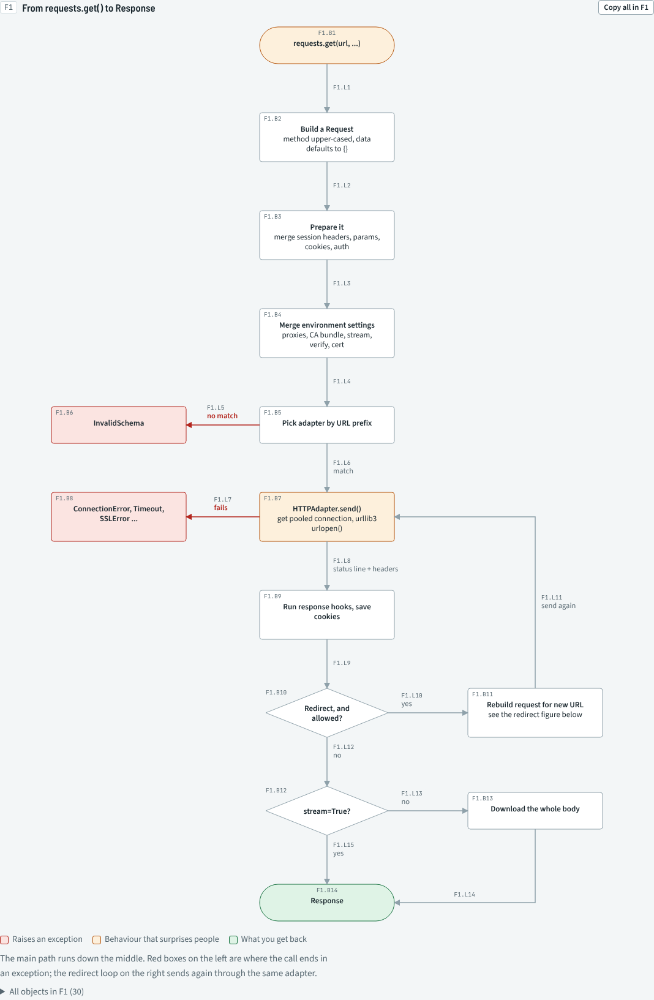
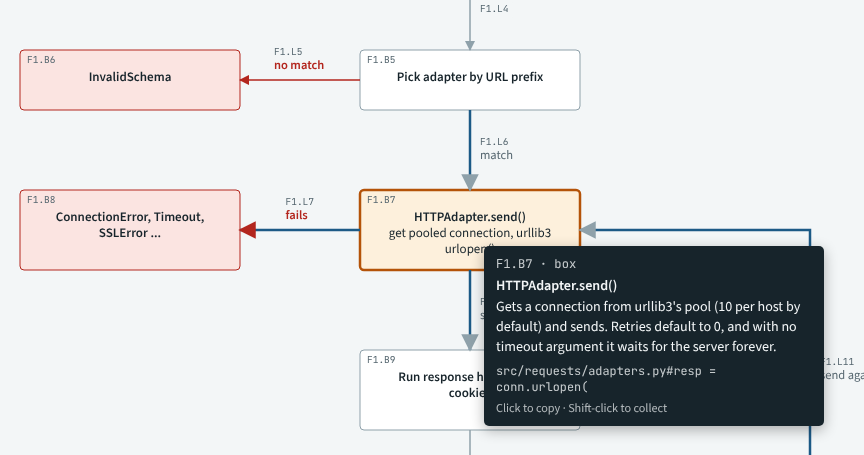
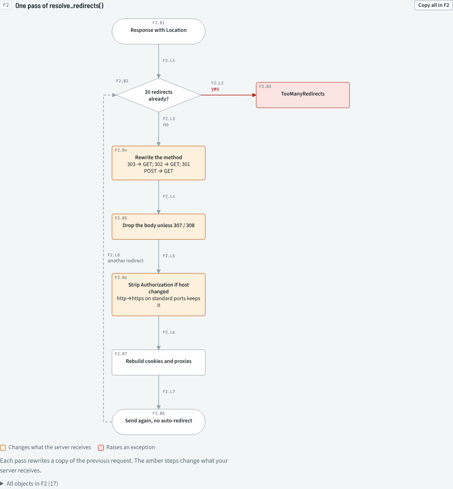
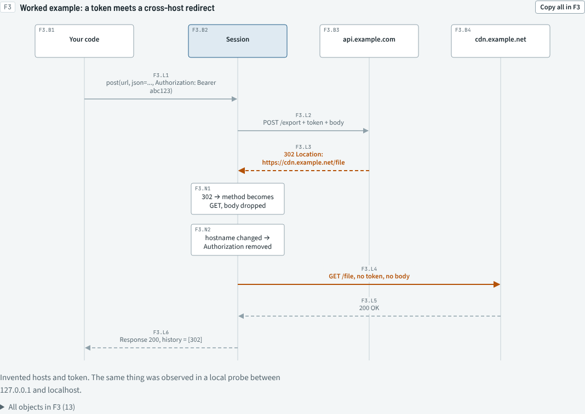
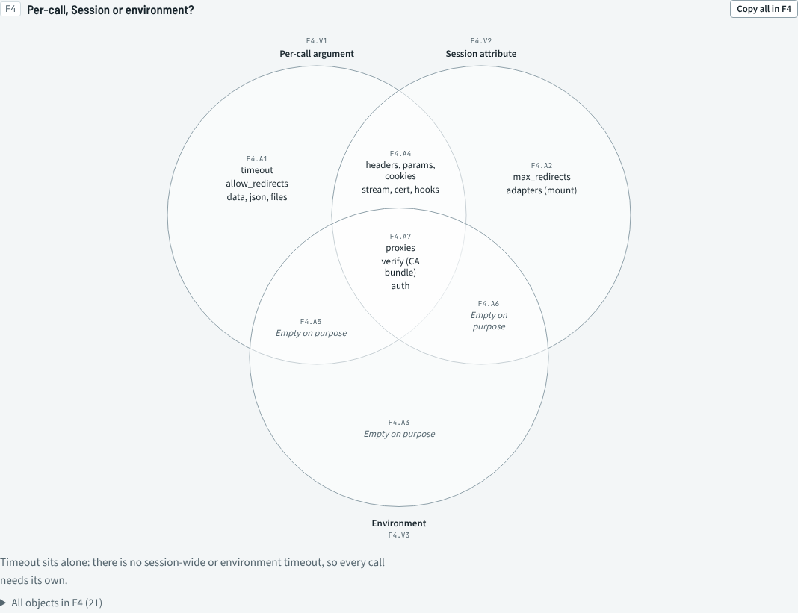
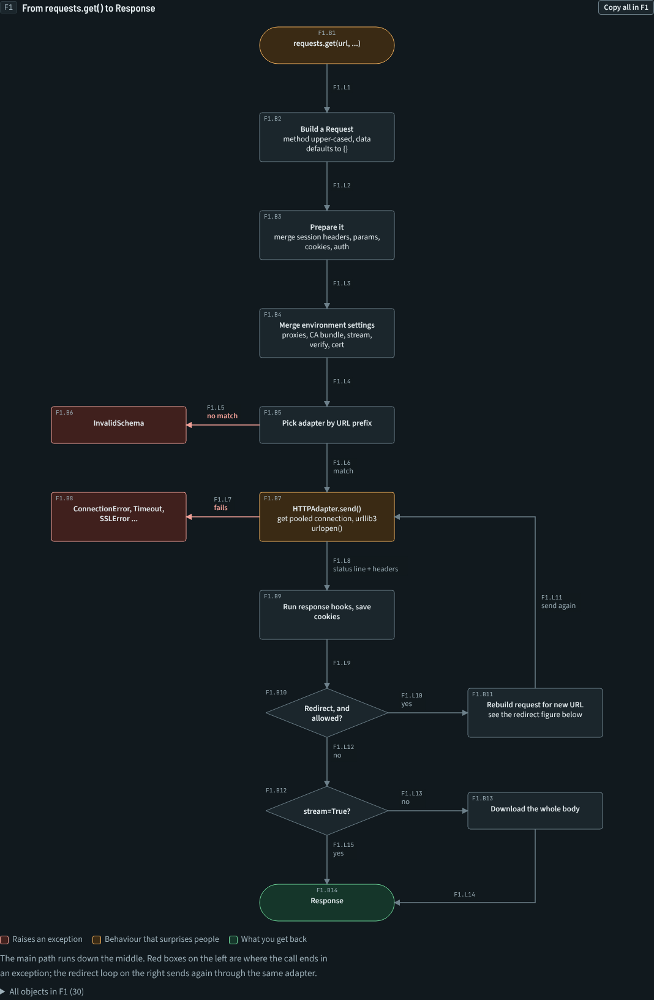
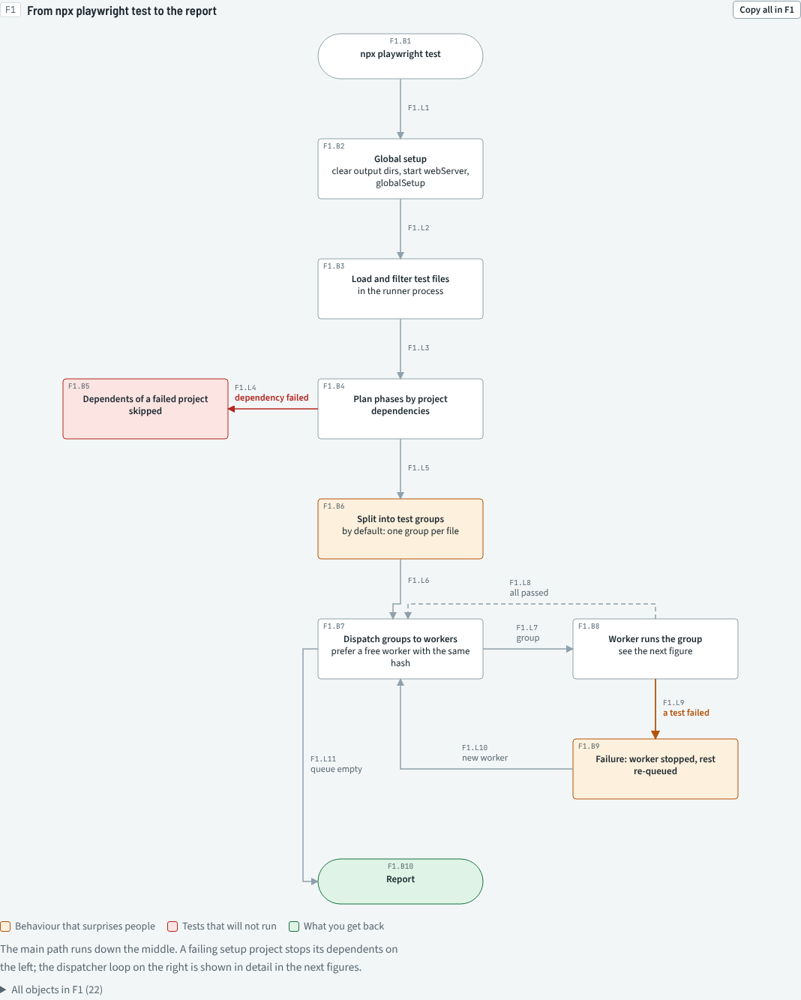
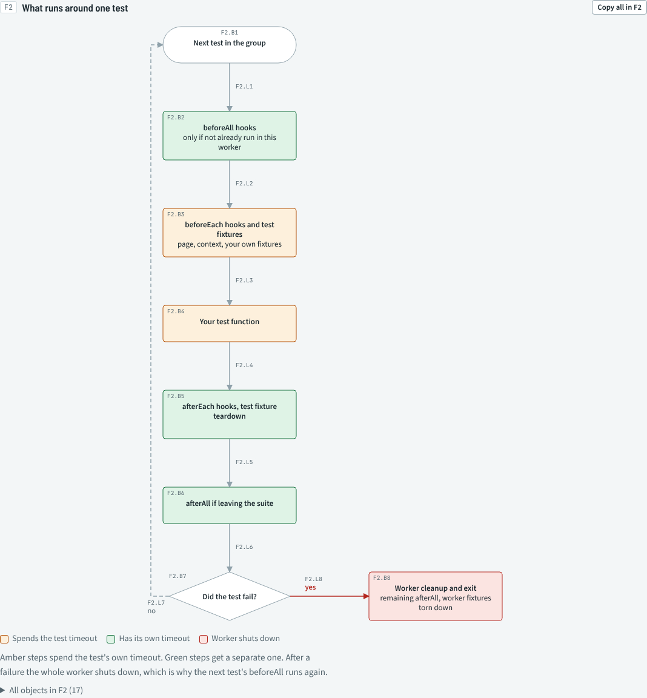
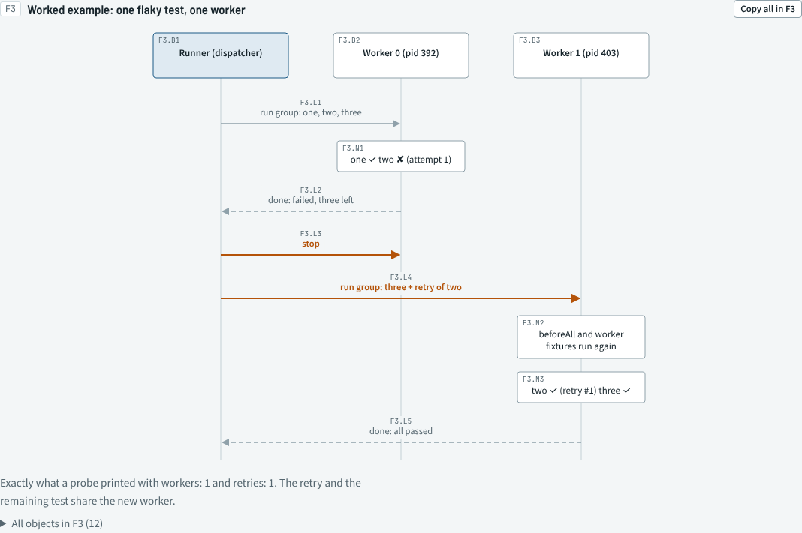

# flow-chart: diagrams you can talk to

A [Claude skill](https://docs.claude.com/en/docs/agents-and-tools/agent-skills/overview) that reads a codebase and draws how it really works: flow charts, sequence diagrams, state machines, class diagrams and Venn diagrams. **Every box, line and table row gets a stable ID** such as `F1.B7`, so you and Claude can point at the exact thing you mean.



*Above: psf/requests, about 6,400 lines of Python, as one figure. Generated by this skill from the source. [Open the live, interactive page](https://htmlpreview.github.io/?https://github.com/naeemakram/flow-chart-skill/blob/main/examples/requests/requests.html).*

## Why

As AI writes more of the code, people spend less time writing it and more time deciding what the system should be. That work needs a shared picture of the system as it is, and mountains of text don't give you one.

A labelled diagram does. With stable IDs you can also discuss it precisely:

> **You:** Why does F1.B7 wait forever?
>
> **Claude:** `HTTPAdapter.send()` passes `timeout=None` to urllib3 when you don't set one, and `Session` has no default timeout (see F4.A1)…

> **You:** Move F2.B6 before F2.B4 and tell me what would break.

Hover any object to see why it exists, what it waits for and what can go wrong. Click it to copy its reference, then paste that into your chat.



## What makes it different

- **True to the code, and it stays that way.** Claude traces behaviour from code, tests and small probes, not from docs alone. Each claim can carry a `source` such as `src/requests/adapters.py#DEFAULT_RETRIES = 0`. The renderer re-checks those quotes against the code, so a stale diagram fails its build and names the object that is now wrong:

  ```
  sources checked: 36, out of date: 1
    STALE T1.R3: src/requests/adapters.py no longer contains 'DEFAULT_RETRIES = 0'
  ```

  Run it in CI, as [this repo does](.github/workflows/ci.yml), and diagrams can't silently drift from the code.
- **IDs are promises.** IDs are never renumbered or reused, so a reference in an old chat, ticket or review still points at the same box.
- **Laid out by script, not by hand.** Claude writes a JSON spec. The renderer places boxes on a grid, routes lines around them and reports crossings and label collisions.
- **One self-contained HTML page** with light and dark themes, a phone layout, find-by-ID and copy-all. It can be committed next to the code, attached to a PR or hosted anywhere.
- **Checked in a real browser.** An optional Playwright check measures text overflow, overlaps and sideways scroll, and tests that hover, copy and find work.

## The example: how `requests` sends one call

[`examples/requests/`](examples/requests/) holds a full flow document for [psf/requests](https://github.com/psf/requests): 4 figures, 1 table, 93 addressable objects and 36 source quotes checked against the code. Two behaviours were also confirmed by running them: a call with no timeout hangs on a silent server, and a redirect to another host drops the `Authorization` header.

| | |
|---|---|
|  |  |
| **What a redirect changes.** Method rewrites, body drops and credential stripping. | **A worked example.** A POST with a token, redirected to another host. |
|  |  |
| **Where settings come from.** `timeout` sits alone: there is no session or environment default. | **Dark mode**, picked automatically. |

[**Open it live**](https://htmlpreview.github.io/?https://github.com/naeemakram/flow-chart-skill/blob/main/examples/requests/requests.html) and hover anything, or download [`requests.html`](examples/requests/requests.html) and open it in a browser.

## Second example: how Playwright Test runs your tests

[`examples/playwright/`](examples/playwright/) maps the Playwright test runner (about 27,000 lines of TypeScript): 3 figures, 1 table, 64 objects and 25 source quotes checked in CI. Four behaviours were confirmed by running @playwright/test 1.64.1:

- After any failed test, the worker process is thrown away and a new one starts.
- The retry runs straight away in that new worker, together with the rest of the file.
- So **`beforeAll` and worker-scoped fixtures run again** after every failure.
- `beforeEach` and test fixtures spend the test's 30 s timeout; `beforeAll` gets its own.

| | |
|---|---|
|  |  |
| **The whole run.** Phases, test groups, and the dispatcher loop. | **One test.** Which steps spend the test timeout, and what a failure tears down. |



[**Open it live**](https://htmlpreview.github.io/?https://github.com/naeemakram/flow-chart-skill/blob/main/examples/playwright/playwright.html), or download [`playwright.html`](examples/playwright/playwright.html).

## Install

### Claude Code, as a plugin (recommended)

In Claude Code 2.1.275 or later:

```
/plugin install flow-chart --marketplace naeemakram/flow-chart-skill
```

On older versions, add the marketplace first, then install:

```
/plugin marketplace add naeemakram/flow-chart-skill
```

```
/plugin install flow-chart@naeemakram
```

Updates arrive through `/plugin update flow-chart`.

### Claude Code, as a plain skill

```bash
git clone https://github.com/naeemakram/flow-chart-skill.git
```

```bash
mkdir -p ~/.claude/skills
```

```bash
cp -r flow-chart-skill/plugin/skills/flow-chart ~/.claude/skills/
```

To install it for one project only, copy it into that project's `.claude/skills/` instead.

### Claude apps (claude.ai, desktop)

Download `flow-chart.zip` from the [latest release](../../releases/latest), then upload it under **Settings → Capabilities → Skills**.

### Requirements

- Python 3.9+ to render. It uses only the standard library.
- Optional, for the browser check: install the Python package `playwright`, then its Chromium browser with `python -m playwright install chromium`.

## Use

Ask in plain words. The skill picks up requests like:

- "Diagram how a request flows through this service"
- "Map out the architecture of this repo"
- "Draw the state machine for an order"
- "Write a system design document for the billing module"
- "Who holds which data? Draw it as a Venn"

Claude traces the code, writes `docs/<name>.spec.json`, renders `docs/<name>.html` and tells you anything it couldn't verify. To change a chart, quote an ID:

> Split F1.B3 into two steps, and add the retry path from F1.B7.

The spec is the source of truth. Commit it next to the page, and Claude edits the spec rather than the HTML.

## What it draws

| Kind | Good for |
|---|---|
| Flow (graph) | Main loops, decisions, error paths |
| Component map (graph with groups) | Services, what each owns, and how they talk |
| State machine (graph) | Anything with a lifecycle |
| Class / module diagram | Key types and their real relationships (UML `rel`s) |
| Sequence | One concrete scenario with realistic values |
| Venn (2–3 sets) | Overlaps: who holds which data, what each test level proves |
| Table | Timers, failure modes, "when X happens during Y" |

The skill also chooses between two document shapes: a **flow document** ("how does it work when it runs?") and a **system design document** ("how is it built, and why this way?"). See [`references/document-types.md`](plugin/skills/flow-chart/references/document-types.md).

## Repository layout

```
.claude-plugin/            marketplace manifest
plugin/                    the plugin itself: the only folder that gets installed
  .claude-plugin/          plugin manifest and icon
  README.md                short README for the plugin directory
  skills/flow-chart/
    SKILL.md               instructions Claude follows
    references/            spec format and document types
    scripts/render.py      spec → HTML, IDs, layout, source checks
    scripts/check_page.py  optional browser check (Playwright)
    assets/                page CSS and JS, inlined into every page
examples/                  example pages
  requests/                the psf/requests example: spec + page
  playwright/              the Playwright test runner example: spec + page
docs/images/               screenshots used in this README
.github/workflows/         CI (render + source check) and release zip
```

## About the author

Made by Naeem Malik. I teach Playwright and test automation at [testautomationtv.com/pw](https://testautomationtv.com/pw). Understanding a system before you test it is half the job, which is why I built this skill.

## License

[MIT](LICENSE). The example describes [psf/requests](https://github.com/psf/requests) (Apache-2.0), quoting short fragments of its source as references.
